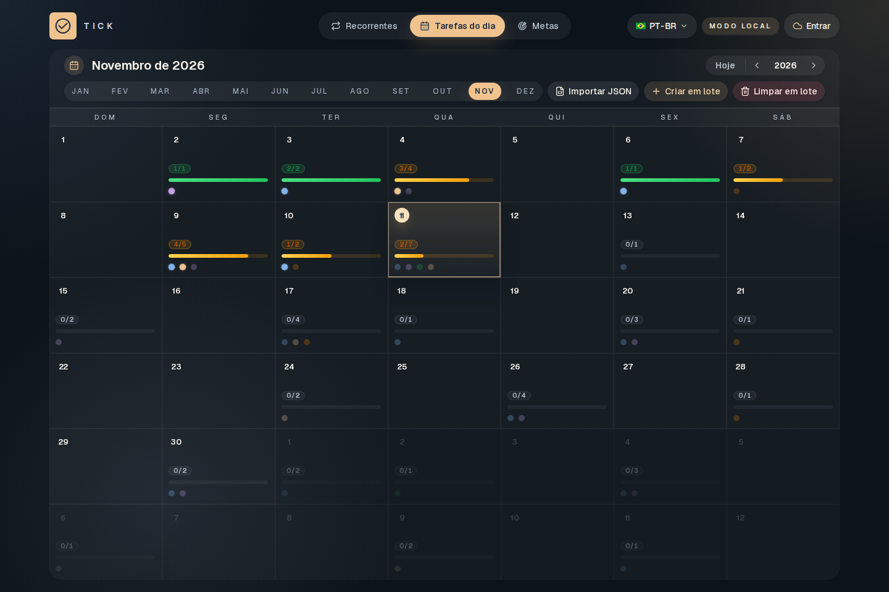
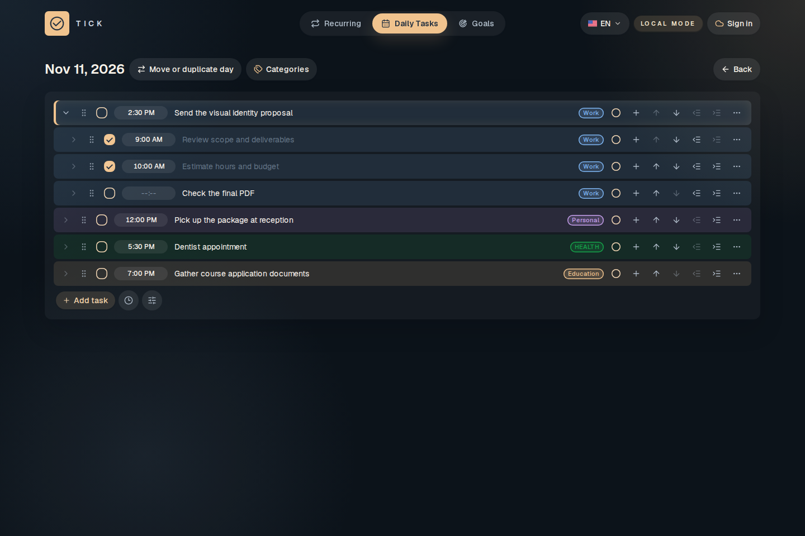
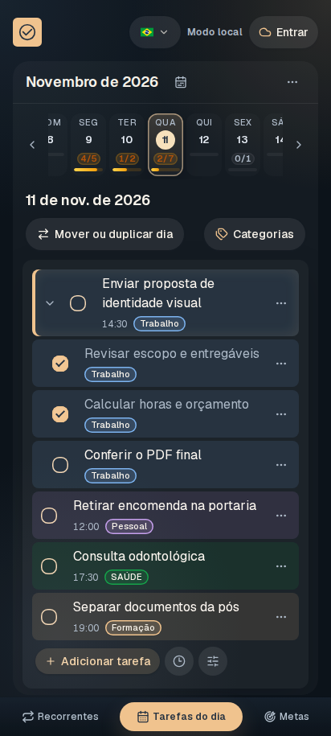
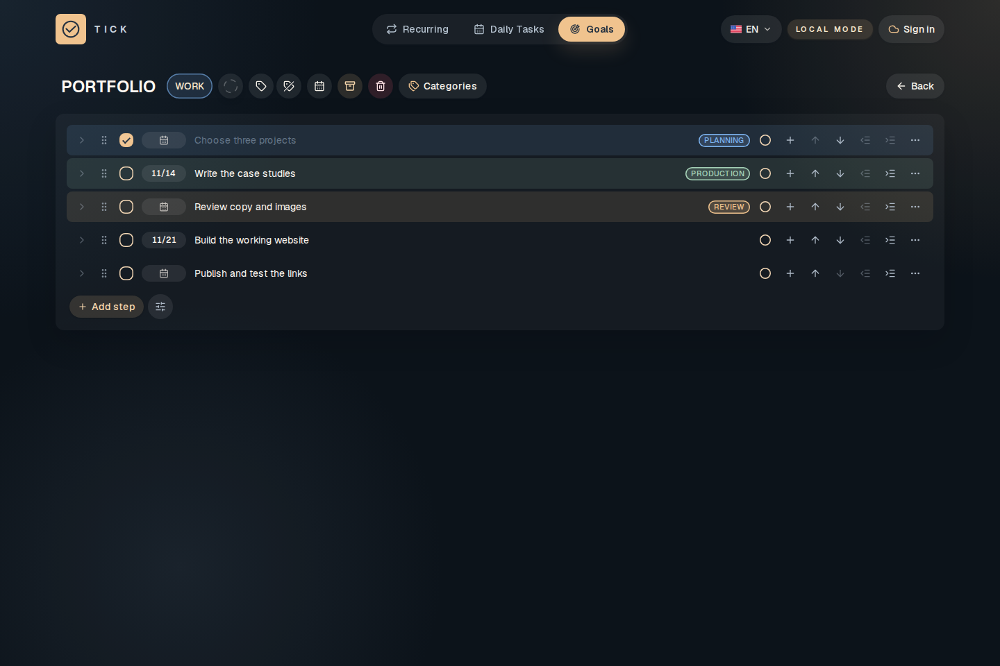
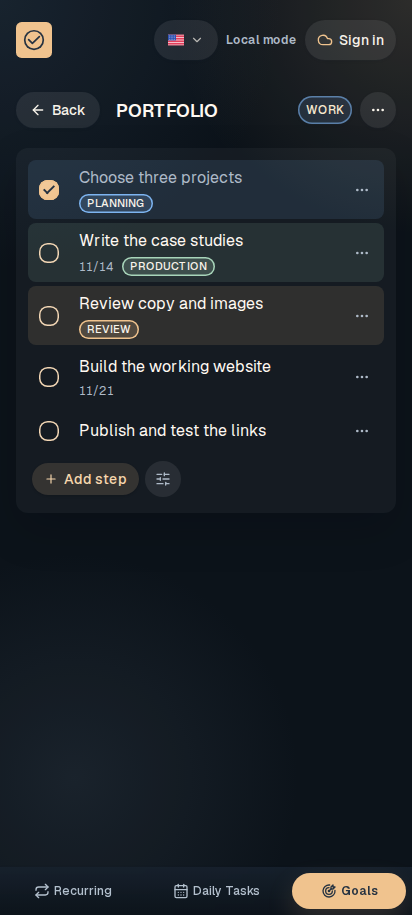
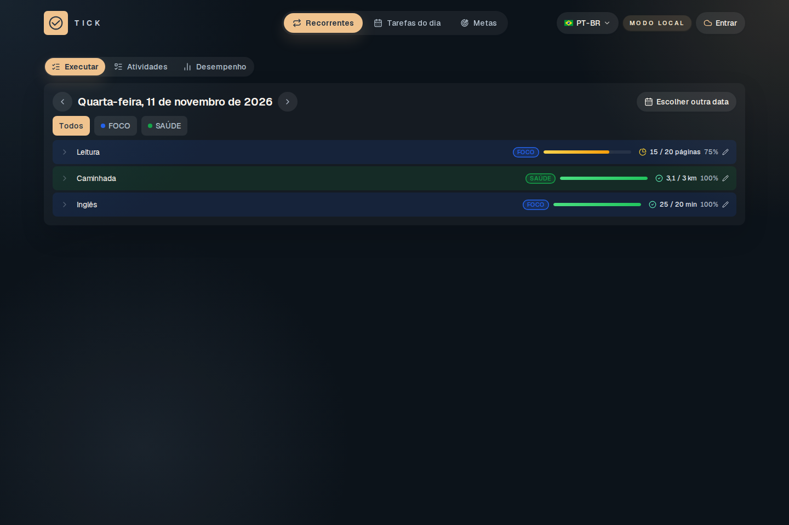
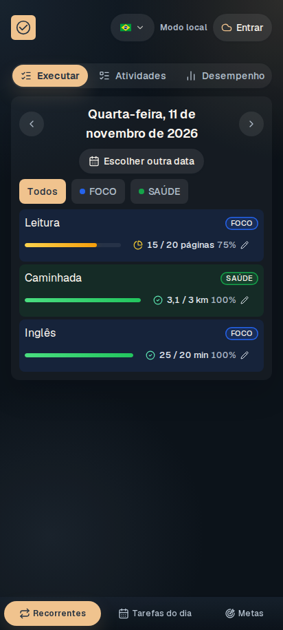

# Tick

Organize suas tarefas, acompanhe atividades recorrentes e avance nas suas metas.

Tick é um aplicativo de produtividade para computador e celular, instalável pelo navegador, com interface em português e inglês.

[Abrir o Tick](https://tickapp.com.br) · [Começar a usar](#comece-a-usar) · [Documentação](#documentação)

## Funcionalidades

- Tarefas e subtarefas organizadas por dia, horário e categoria.
- Metas divididas em etapas e reunidas em grupos.
- Atividades recorrentes com frequências, quantidades, desempenho e histórico.
- Categorias, preferências de visualização e marcação de progresso.
- Modo local gratuito, sem conta e sem limites de tempo ou quantidade impostos pelo produto.
- Instalação como aplicativo e uso offline conforme os recursos disponíveis no dispositivo.
- Português e inglês, com datas e horários no formato de cada idioma.

## Veja o aplicativo

### Calendário e tarefas do dia

Navegue pelo mês, organize o dia e acompanhe tarefas com subtarefas, horários e categorias. No celular, a agenda combina a semana e o dia selecionado.

<table>
  <tr>
    <td width="72%"></td>
    <td width="28%"></td>
  </tr>
</table>

### Metas e etapas

Divida resultados em etapas, atribua categorias e defina datas nas entregas intermediárias.

<table>
  <tr>
    <td width="72%"></td>
    <td width="28%"></td>
  </tr>
</table>

### Atividades recorrentes

Registre atividades binárias ou quantitativas e acompanhe o realizado em relação à meta.

<table>
  <tr>
    <td width="72%"></td>
    <td width="28%"></td>
  </tr>
</table>

As capturas usam dados fictícios e alternam telas em português e inglês. Os guias abaixo mostram também visão geral de metas, preferências, desempenho e histórico.

## Comece a usar

Abra [tickapp.com.br](https://tickapp.com.br) e escolha **Usar sem conta**. Seus dados ficam neste navegador, perfil e dispositivo e permanecem disponíveis ao fechar e reabrir o aplicativo.

O acesso com conta é restrito a convidados autorizados e permite sincronização entre dispositivos. Entrar em uma conta não transfere automaticamente os dados do modo local.

## Instale no seu dispositivo

Abra o site e use a opção de instalar aplicativo oferecida pelo navegador. No Android, procure **Instalar aplicativo** ou **Adicionar à tela inicial**. No iPhone e iPad, use **Compartilhar → Adicionar à Tela de Início** no Safari.

Consulte [Acesso e instalação](docs/guides/ACESSO-E-INSTALACAO.md) para entender armazenamento, contas e uso sem internet.

## Documentação

| Preciso de…                                      | Leia                                                                                                                                            |
| ------------------------------------------------ | ----------------------------------------------------------------------------------------------------------------------------------------------- |
| Começar, instalar e entender onde ficam os dados | [Acesso e instalação](docs/guides/ACESSO-E-INSTALACAO.md)                                                                                       |
| Organizar o calendário e o dia                   | [Tarefas do dia](docs/guides/TAREFAS-DO-DIA.md)                                                                                                 |
| Acompanhar projetos e resultados                 | [Metas e etapas](docs/guides/METAS.md)                                                                                                          |
| Registrar atividades que se repetem              | [Atividades recorrentes](docs/guides/RECORRENTES.md)                                                                                            |
| Configurar categorias, ações e visualização      | [Categorias e preferências](docs/guides/CATEGORIAS-E-PREFERENCIAS.md)                                                                           |
| Inserir tarefas por JSON                         | [Importação de tarefas](docs/guides/IMPORTACAO-DE-TAREFAS.md)                                                                                   |
| Executar e desenvolver o projeto                 | [Desenvolvimento](docs/development/DESENVOLVIMENTO.md)                                                                                          |
| Trabalhar com agentes                            | [AGENTS.md](AGENTS.md)                                                                                                                          |
| Revisar mudanças e conferir gates                | [REVIEW.md](REVIEW.md)                                                                                                                          |
| Projetar ou revisar a interface                  | [Skill de frontend](.agents/skills/frontend-design/SKILL.md)                                                                                    |
| Configurar serviços e credenciais                | [Ambiente de produção](docs/operations/AMBIENTE-DE-PRODUCAO.md)                                                                                 |
| Publicar e retomar uma publicação                | [Publicação](docs/operations/PUBLICACAO.md)                                                                                                     |
| Monitorar, recuperar ou restaurar dados          | [Monitoramento e recuperação](docs/operations/MONITORAMENTO-E-RECUPERACAO.md) · [Teste de restauração](docs/operations/TESTE-DE-RESTAURACAO.md) |
| Investigar desempenho ou manter pacotes          | [Diagnóstico de desempenho](docs/operations/DIAGNOSTICO-DE-DESEMPENHO.md) · [Dependências](docs/operations/DEPENDENCIAS.md)                     |
| Consultar trabalho ainda aberto                  | [Pendências](docs/planning/PENDENCIAS.md)                                                                                                       |
