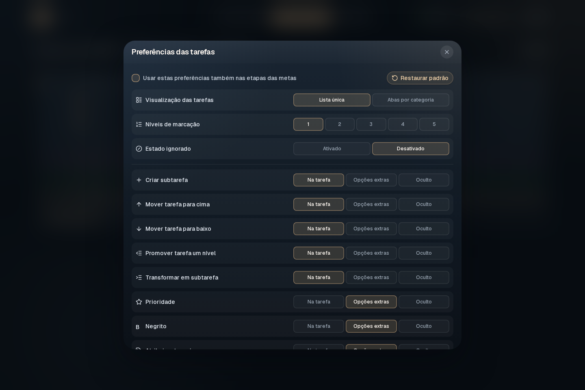
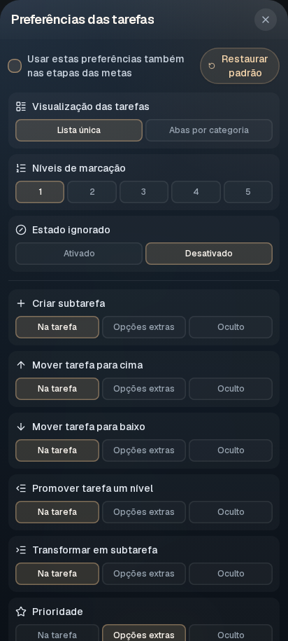

# Categorias e preferências

[Apresentação do Tick](../../README.md) · [Tarefas do dia](TAREFAS-DO-DIA.md) · [Metas](METAS.md)

## Categorias por contexto

Abra **Categorias** na área que deseja organizar. Tarefas do dia, grupos de metas, metas, etapas e recorrentes têm categorias independentes. Criar ou atribuir uma categoria em uma área não modifica automaticamente as outras.

Crie o nome e escolha a cor; depois atribua a categoria pelas ações do item. Use a ação de remover categoria para deixar o item sem marcador. Cores identificam categorias e não representam, por si, sucesso, erro ou conclusão.

No celular, o gerenciamento das categorias fica à direita nas barras de tarefas e na visão geral de metas. A atribuição individual continua nas ações do item.

Em metas e grupos, o controle de cor também permite destaque próprio do item, sem atribuir uma categoria compartilhada. Essa cor não cria uma categoria reutilizável nas outras superfícies.

## Lista única ou abas

Nas preferências de tarefas ou etapas, escolha **Lista única** para ver os itens juntos ou **Abas por categoria** para filtrá-los por categoria. As abas dependem das categorias disponíveis naquele contexto.

## Preferências das linhas

Abra o botão de preferências junto de **Adicionar tarefa** ou **Adicionar etapa**. Para cada ação, escolha se aparece diretamente na linha, nas opções extras ou fica oculta. No toque, a composição usa o menu da linha para preservar o espaço de leitura.

Configure também os níveis de marcação e o estado ignorado. As preferências pertencem ao contexto selecionado; a opção de aplicar também à outra superfície é explícita. **Restaurar padrão** repõe as escolhas padrão do modal.

<table>
  <tr>
    <td width="72%"></td>
    <td width="28%"></td>
  </tr>
</table>

## Idioma

Use o seletor com a bandeira no cabeçalho para escolher **Português (Brasil)** ou **English**. O idioma altera a interface e os formatos de datas, horários e quantidades, sem traduzir os títulos ou nomes que você escreveu. O tema visual é sempre escuro, independentemente do tema do sistema.
