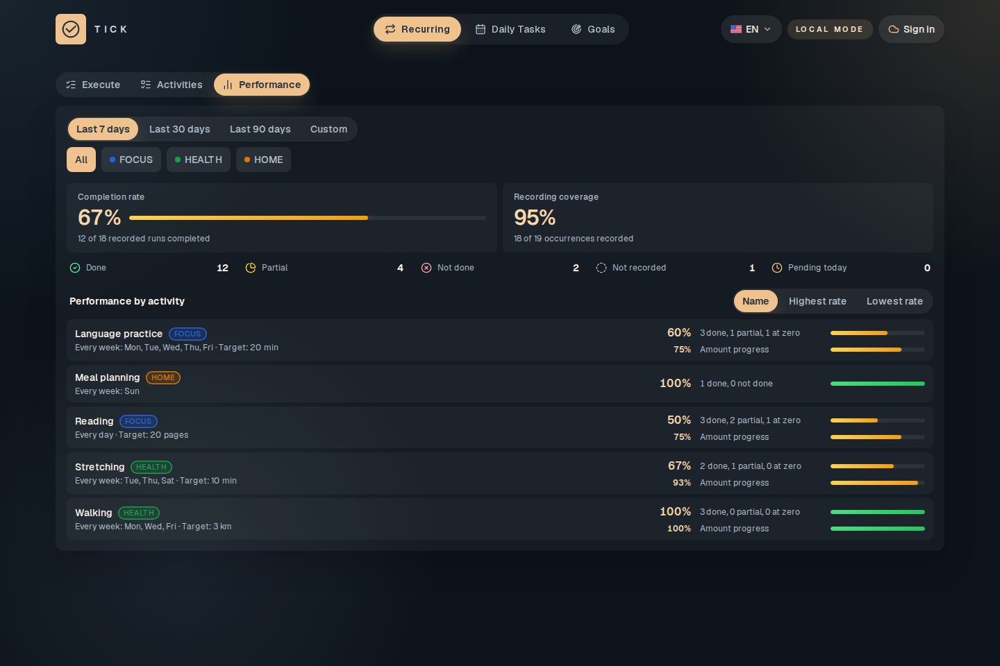
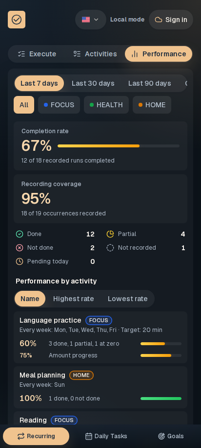
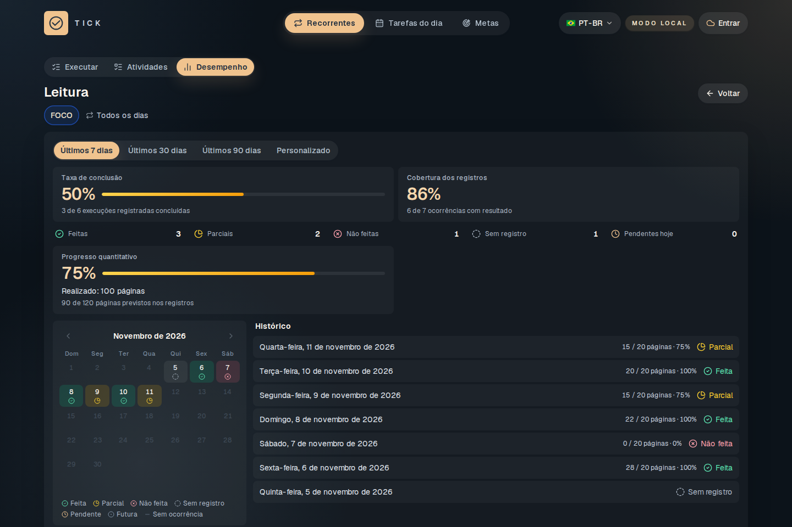
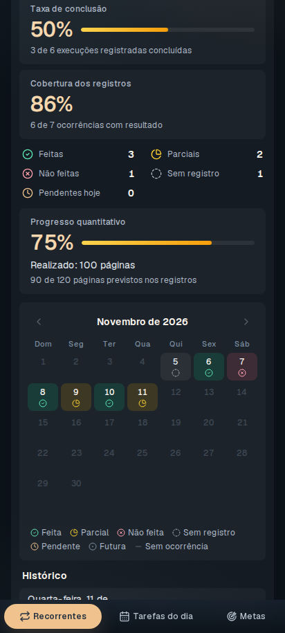

# Atividades recorrentes

[Apresentação do Tick](../../README.md) · [Categorias e preferências](CATEGORIAS-E-PREFERENCIAS.md)

## Criar uma atividade

Em **Recorrentes**, abra **Atividades** e use **Nova atividade**. Defina nome, categoria e frequência. As opções cobrem intervalos de dias, dias da semana e frequências mensais. Revise os campos específicos da opção escolhida antes de salvar.

Uma atividade pode ser binária, como planejar refeições, ou quantitativa, como ler 20 páginas. A atividade também pode conter subtarefas. Uma medida pertence a um item folha: um agrupador com subtarefas não recebe uma meta quantitativa própria.

## Executar e registrar quantidades

Em **Executar**, escolha a data e registre o resultado de cada atividade. Para uma quantidade, informe o valor realizado na unidade definida. Um novo registro substitui o valor daquele dia; ele não soma ao anterior.

- **Sem registro:** nenhum valor foi informado, ou o registro foi limpo.
- **Não feita:** valor zero, ou resposta binária negativa.
- **Parcial:** quantidade maior que zero e abaixo da meta.
- **Feita:** quantidade igual ou acima da meta, ou resposta binária positiva.

O realizado pode ultrapassar a meta. O indicador de progresso usa o limite da meta; os totais quantitativos preservam o valor realizado. Unidades diferentes não são somadas.

No celular, nome e categoria ficam separados da linha de quantidade e progresso. Use a ação de registrar para abrir o formulário de quantidade. Datas futuras não aceitam respostas de execução.

## Administrar e pausar

**Atividades** permite procurar por nome e filtrar por situação ou categoria. Nas ações de uma atividade, edite, pause, reative ou exclua conforme a necessidade. Pausar muda a programação; não é uma resposta de conclusão do dia.

Quando há respostas anteriores, alterações podem pedir a escolha de como aplicar o novo conteúdo. Mudanças da medida preservam os valores históricos e passam a valer a partir do dia seguinte.

## Desempenho

Abra **Desempenho** e escolha um período ou intervalo personalizado. Os indicadores distinguem conclusão, cobertura dos registros e progresso quantitativo. Um dia sem registro não equivale a um registro de zero; uma quantidade parcial ainda não atingiu a meta na taxa de conclusão.

<table>
  <tr>
    <td width="72%"></td>
    <td width="28%"></td>
  </tr>
</table>

## Histórico

Use **Ver histórico** na atividade para abrir seus resultados no período, com calendário mensal e lista cronológica. As quantidades são interpretadas com a meta e a unidade vigentes na época do registro.

<table>
  <tr>
    <td width="72%"></td>
    <td width="28%"></td>
  </tr>
</table>

A visualização e a atividade consultada ficam na navegação do aplicativo; voltar no navegador restaura o contexto. Recorrentes são independentes das tarefas do dia e das metas.
